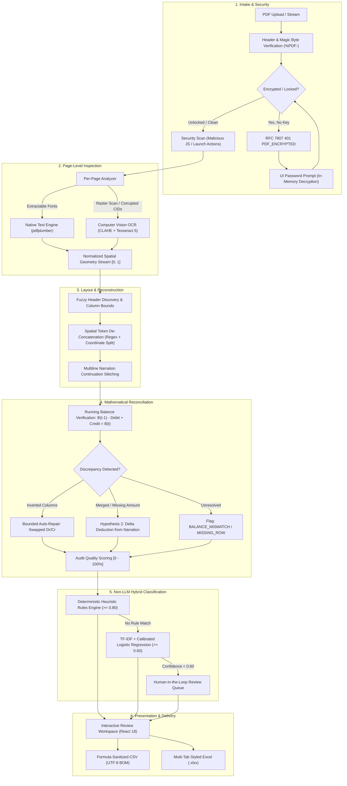

# Bank Statement Processing & Classification System
### Befree AI & Automation Internship Assessment — Australia & UK Focused MVP

[](https://www.python.org/)
[](https://fastapi.tiangolo.com/)
[](https://react.dev/)
[](https://www.typescriptlang.org/)
[](https://tailwindcss.com/)
[](https://scikit-learn.org/)
[](LICENSE)

A production-grade, privacy-centric Document-AI web application engineered to ingest, extract, reconcile, and classify bank statements across diverse layouts without external cloud dependencies or LLMs.

Prioritized for **Australia (CommBank, Westpac, ANZ)** and the **United Kingdom (Barclays, HSBC, NatWest)** with country-aware support for **India (SBI, HDFC)**, this system is designed for high-throughput, deterministic financial document intake.

---

## Architecture Overview



---

## Core Engineering Principles

### 1. Zero-LLM & Fully Local Processing
- **Predictable & Reproducible**: Transaction classification runs deterministically using a prioritized rule engine (regex merchant normalization) combined with a calibrated `scikit-learn` Logistic Regression classifier.
- **Privacy & Cost**: Zero external cloud APIs, zero third-party data leaks, zero tokens billed per page. Financial data never leaves the runtime environment.
- **Strict Guardrail**: Automated linting and tests fail if any LLM SDK (`openai`, `anthropic`, `langchain`, `transformers`) appears in dependencies.

### 2. Strict Monetary Arithmetic
- Floating-point representations (`0.1 + 0.2 != 0.3`) are banned from financial logic.
- Python `Decimal` is used across all extraction, reconciliation, and export calculations.
- Decimal strings are used in JSON transport and frontend display, preventing IEEE 754 precision errors.

### 3. Truth-Preserving Auditability
- The system **never fabricates data**. If an amount or date cannot be extracted with high confidence, it is marked as `null` and assigned an audit flag rather than guessed.
- Repaired values retain their raw, untouched representations alongside repair audit logs (`raw_debit`, `raw_credit`, `raw_balance`, `flags`).

---

## Key Capabilities & Edge-Case Catalog

| Challenge / Edge Case | Engineering Solution | Traceability |
| :--- | :--- | :--- |
| **Password-Protected PDFs** | In-memory `pikepdf` decryption. Returns RFC 7807 `401 PDF_ENCRYPTED` or `WRONG_PASSWORD`. UI renders a dedicated `PasswordDialog` with show/hide toggle. Zero storage of credentials. | [`app/api/v1/statements.py`](backend/app/api/v1/statements.py) |
| **Glued Columns & Agglutination** | When merchant narrations collide with money columns (e.g. `BOOTS PICCADILLY18.30`), the coordinate tokenizer performs regex token splitting (`r"^([A-Za-z]+)(\d+\.\d{2})$"`) with proportional bounding box subdivision. | [`app/pipeline/layout/row_builder.py`](backend/app/pipeline/layout/row_builder.py) |
| **Swallowed Amounts in Narrations** | If an amount is missing, the reconciliation engine calculates $\Delta = B_{prev} - B_{curr}$. If $\Delta$ matches the description suffix, it extracts the debit, trims the narration, and flags `INFERRED_AMOUNT`. | [`app/pipeline/validate/reconcile.py`](backend/app/pipeline/validate/reconcile.py) |
| **Scanned & Degraded Pages** | Page-level inspector calculates text density, non-printing garbage characters (`(cid:N)`, `\ufffd`), and image area ratios. Automatically triggers OpenCV CLAHE thresholding and Tesseract 5 OCR when needed. | [`app/pipeline/pdf_type.py`](backend/app/pipeline/pdf_type.py) |
| **Inverted Debit/Credit Columns** | Validates $B_{prev} - D + C = B_{curr}$. If invalid, tests whether swapping Debit and Credit reconciles the equation ($B_{prev} + D - C = B_{curr}$). If so, repairs columns with flag `REPAIRED_DIRECTION`. | [`app/pipeline/validate/reconcile.py`](backend/app/pipeline/validate/reconcile.py) |
| **Multi-Line Narrations** | Continuation lines lacking dates or amounts are re-assembled into the parent transaction's narration block, preserving spatial order and line breaks. | [`app/pipeline/layout/row_builder.py`](backend/app/pipeline/layout/row_builder.py) |
| **Spreadsheet Formula Injection** | Prevents CSV/Excel formula execution by sanitizing all cells starting with `=`, `+`, `-`, or `@` with a leading apostrophe (`'`). | [`app/export/csv_exporter.py`](backend/app/export/csv_exporter.py), [`xlsx_exporter.py`](backend/app/export/xlsx_exporter.py) |

---

## Geographic & Banking Support

The pipeline dynamically adapts to locale-specific bank statement schemas:

```
├── Australia (Primary)
│   ├── Currency: AUD ($)
│   ├── Date Formats: DD/MM/YYYY, DD-MMM-YYYY
│   ├── Identifiers: BSB (XXX-XXX) & Account Number
│   ├── Payment Rails: PayID, Osko, EFTPOS, Direct Debit
│   └── Supported Profiles: Commonwealth Bank of Australia (CBA), Westpac, ANZ
│
├── United Kingdom (Primary)
│   ├── Currency: GBP (£)
│   ├── Date Formats: DD/MM/YYYY, DD MMM YYYY
│   ├── Identifiers: Sort Code (XX-XX-XX) & Account Number (8 digits)
│   ├── Payment Rails: BACS, Faster Payments, Direct Debit, CHAPS
│   └── Supported Profiles: Barclays, HSBC, NatWest
│
└── India (Secondary / Country-Aware)
    ├── Currency: INR (₹)
    ├── Date Formats: DD/MM/YYYY
    ├── Identifiers: IFSC Code & Account Number
    ├── Payment Rails: UPI, NEFT, RTGS, IMPS
    └── Supported Profiles: State Bank of India (SBI), HDFC Bank
```

---

## Technology Stack

### Backend
- **Framework**: Python 3.11+, FastAPI, Uvicorn, Pydantic v2
- **PDF & Document AI**: `pdfplumber`, `pdfminer.six`, `pypdfium2`, `pikepdf`, `pytesseract` (Tesseract 5), `opencv-python-headless`, `NumPy`, `Pillow`
- **NLP & Classification**: `RapidFuzz` (token ratio string alignment), `scikit-learn` (TF-IDF + Calibrated Logistic Regression), `joblib`
- **Data & Export**: `python-dateutil`, `XlsxWriter` (formula defense)
- **Testing**: `pytest`, `httpx`, `ReportLab` (synthetic fixture generation)

### Frontend
- **Framework**: React 18, TypeScript, Vite
- **Styling & UI**: Tailwind CSS v4, Lucide React
- **State & Networking**: Native Async/Await, RFC 7807 Error Interceptor

---

## Getting Started

### Prerequisites
- Python 3.11+
- Node.js 18+ & npm
- Tesseract OCR (Optional for native PDFs; required for scanned image OCR)

---

### Option A: Running with Docker Compose (Recommended)

```bash
# Clone the repository
git clone https://github.com/bhavya-229/BeFree-automation-assessment.git
cd BeFree-automation-assessment

# Start both backend and frontend services
docker compose up --build
```

- **Frontend App**: [http://localhost:5173](http://localhost:5173)
- **FastAPI OpenAPI Swagger**: [http://localhost:8000/api/docs](http://localhost:8000/api/docs)
- **Backend Health Check**: [http://localhost:8000/api/v1/health](http://localhost:8000/api/v1/health)

---

### Option B: Running Locally

#### 1. Backend Setup
```bash
# In repository root
python -m venv .venv

# On Windows:
.venv\Scripts\activate
# On Linux/macOS:
# source .venv/bin/activate

# Install dependencies
pip install -e backend/.[dev]

# Start FastAPI server
python backend/run_dev.py
```
*Backend runs on `http://127.0.0.1:8000`.*

#### 2. Frontend Setup
```bash
# In a separate terminal
cd frontend
npm install
npm run dev
```
*Frontend runs on `http://localhost:5173`.*

---

## Testing with Pre-Bundled Statement Fixtures

The repository includes synthetic, realistic bank statement PDFs in `data/samples/`. You can either:
1. Click **"Run in App"** directly on any sample card in the web UI.
2. Click **"PDF"** to download the fixture and test drag-and-drop file upload.

| Fixture Name | Bank & Region | Characteristics Tested |
| :--- | :--- | :--- |
| **`cba_australian_statement.pdf`** | CommBank (AU) | Native digital text, AUD currency, BSB formatting, Woolworths / Telstra merchant rules. |
| **`barclays_uk_statement.pdf`** | Barclays (UK) | Native digital text, GBP currency, Sort Code, Boots tight narration-amount boundary. |
| **`westpac_australian_statement.pdf`**| Westpac (AU) | Multiline payment references, BPAY & direct debit narrations. |
| **`sbi_india_statement.pdf`** | SBI (IN) | Day-first date parsing, INR currency, IFSC metadata extraction. |
| **`encrypted_cba_statement.pdf`** | CommBank (AU) | 128-bit PDF encryption. Triggers `PasswordDialog` in UI. **Password: `befree2026`**. |

To regenerate or customize fixtures:
```bash
python backend/scripts/make_fixtures.py
```

---

## Automated Test Suite

The test suite validates the complete ingestion pipeline, spatial layout reconstruction, password security, mathematical ledger checks, and non-LLM classifiers:

```bash
# Run pytest across the entire test suite
pytest backend/tests -v
```

### Test Coverage Highlights:
- `test_intake.py`: Magic byte validation, file size limits, corrupt stream rejection.
- `test_pdf_type.py`: Page-level digital vs. scanned vs. hybrid classification.
- `test_extraction.py`: Spatial word extraction and coordinate mapping.
- `test_parsing.py`: Country-aware date formats (`DD/MM/YYYY`, `DD-MMM-YYYY`), amount normalizers.
- `test_reconcile.py`: Running balance ledger checks, inverted column repairs, delta amount recovery.
- `test_classifier.py`: Rule priority, regex merchant normalization, calibrated ML inference.
- `test_export.py`: Formula injection neutralization (`'` prefix), CSV BOM encoding, XLSX structures.
- `test_api.py`: End-to-end API lifecycle: upload, encrypted 401 handling, patch category, export CSV/XLSX.

---

## REST API Specification

| Method | Endpoint | Description |
| :--- | :--- | :--- |
| `GET` | `/api/v1/health` | Service health status. |
| `POST` | `/api/v1/statements` | Upload and process statement PDF. Accepts multipart `file` and optional `password`. |
| `GET` | `/api/v1/statements/{id}` | Retrieve parsed statement record, provenance metadata, and transactions. |
| `PATCH`| `/api/v1/statements/{id}/transactions/{tx_id}` | Human-in-the-loop review: update transaction category with audit record. |
| `GET` | `/api/v1/statements/{id}/export/csv` | Download formula-safe CSV file (UTF-8 BOM). |
| `GET` | `/api/v1/statements/{id}/export/xlsx` | Download formatted Excel workbook. |
| `POST` | `/api/v1/statements/samples/{key}` | Process pre-bundled demo fixture (`cba`, `barclays`, `westpac`, `sbi`, `encrypted`). |
| `GET` | `/api/v1/statements/samples/{key}/download` | Download raw synthetic sample PDF. |

---

## Project Structure

```
beFree/
├── backend/
│   ├── app/
│   │   ├── api/v1/                 # REST endpoints (statements, export, review)
│   │   ├── classification/         # Non-LLM classifier (rules engine, TF-IDF + Logistic Regression)
│   │   ├── core/                   # Storage abstraction and utility helpers
│   │   ├── export/                 # Formula-safe CSV & XLSX export engines
│   │   ├── pipeline/
│   │   │   ├── bank_profiles/      # Bank layout profiles (AU CBA, UK Barclays, Generic)
│   │   │   ├── layout/             # Spatial table detector & multiline row builder
│   │   │   ├── ocr/                # OpenCV CLAHE preprocessing & Tesseract engine
│   │   │   ├── parse/              # Dates, amounts, and account metadata parsers
│   │   │   └── validate/           # Running balance reconciler & auto-repair logic
│   │   ├── schemas/                # Pydantic data schemas & transaction contracts
│   │   ├── errors.py               # RFC 7807 problem+json error handlers
│   │   └── main.py                 # FastAPI application factory
│   ├── scripts/
│   │   └── make_fixtures.py        # ReportLab synthetic statement generator
│   └── tests/                      # 33 unit and end-to-end pytest tests
│
├── frontend/
│   ├── src/
│   │   ├── components/
│   │   │   ├── AccountDetailsCard.tsx  # Bank metadata with Mask/Reveal toggle
│   │   │   ├── FileUpload.tsx          # Drag-and-drop dropzone & demo fixture bar
│   │   │   ├── Header.tsx              # Fintech gradient header & taxonomy modal
│   │   │   ├── PasswordDialog.tsx      # Modal for encrypted statement decryption
│   │   │   ├── StatementInsights.tsx   # Spend distribution & category breakdown
│   │   │   ├── StatementOverview.tsx   # Workspace coordinator (4 tab navigation)
│   │   │   ├── StatementValidation.tsx # Mathematical balance proof ledger
│   │   │   └── TransactionTable.tsx    # Live grid with drawer audit & in-place edit
│   │   ├── lib/api.ts                  # Typed API client with 401 error interceptor
│   │   └── types/index.ts              # TypeScript domain types
│   ├── Dockerfile
│   └── vite.config.ts
│
├── data/
│   ├── samples/                    # Pre-generated synthetic PDF statements
│   └── uploads/                    # Local temporary processing storage (.gitkeep)
├── docs/                           # Architectural Decision Records & Deep-Dive Specs
├── docker-compose.yml
└── README.md
```

---

## Author & Contact

**Bhavya Dubal**  
- **Email**: [bhavyadubal@gmail.com](mailto:bhavyadubal@gmail.com)  
- **GitHub**: [@bhavya-229](https://github.com/bhavya-229)  
- **Repository**: [https://github.com/bhavya-229/BeFree-automation-assessment](https://github.com/bhavya-229/BeFree-automation-assessment)
