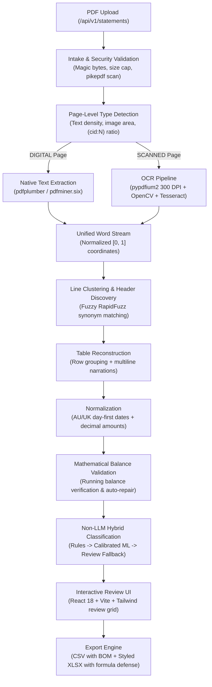

# System Architecture & Technical Specifications

## 1. Architectural Pipeline

The system is designed as an end-to-end document processing pipeline that converts raw, heterogeneous bank statement PDFs into validated, categorized accounting tables.

---

## 2. Component Specifications

### 2.1 Backend (`FastAPI + Python 3.11+`)
- **Intake (`app/pipeline/intake.py`)**: Validates `%PDF-` magic bytes, scans for embedded malicious actions (`/JavaScript`, `/Launch`), checks page and size caps.
- **Type Detector (`app/pipeline/pdf_type.py`)**: Computes character counts, garbage ratios (`\ufffd`, `\ue000`, `(cid:N)`), image area ratios, classifying pages as `DIGITAL`, `SCANNED`, or `HYBRID`.
- **Extraction (`app/pipeline/native_extract.py`, `app/pipeline/ocr/`)**: Emits normalized `Word` streams with bounding box geometry.
- **Layout & Row Reconstruction (`app/pipeline/layout/`)**: Discovers table columns and reconstructs multiline transaction descriptions.
- **Validation (`app/pipeline/validate/reconcile.py`)**: Validates `prev_balance - debit + credit == balance`. Auto-repairs inverted columns, flags discrepancies, and never fabricates values.
- **Classification (`app/classification/`)**: Rule engine + TF-IDF Logistic Regression.
- **Export (`app/export/`)**: Sanitizes formula injection (`=`, `+`, `-`, `@`) and produces CSV (with UTF-8 BOM) and XLSX workbooks.

### 2.2 Frontend (`React 18 + TypeScript + Vite + Tailwind CSS`)
- Single-page application providing drag-and-drop file upload, KPI cards, interactive review table, in-place category correction, search/filters, and instant export downloads.
